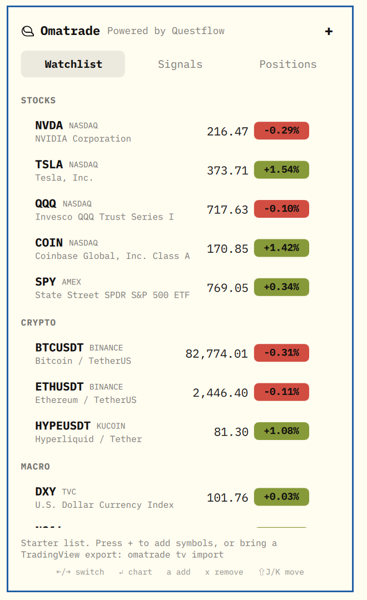
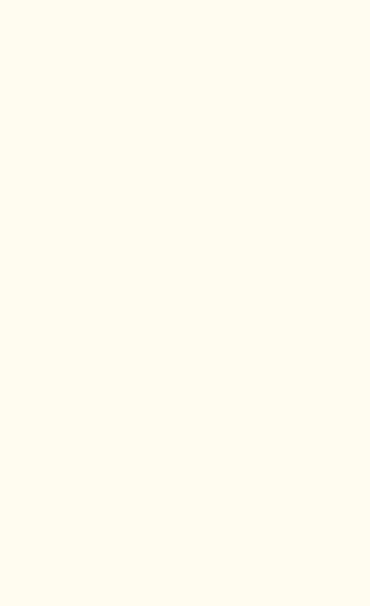
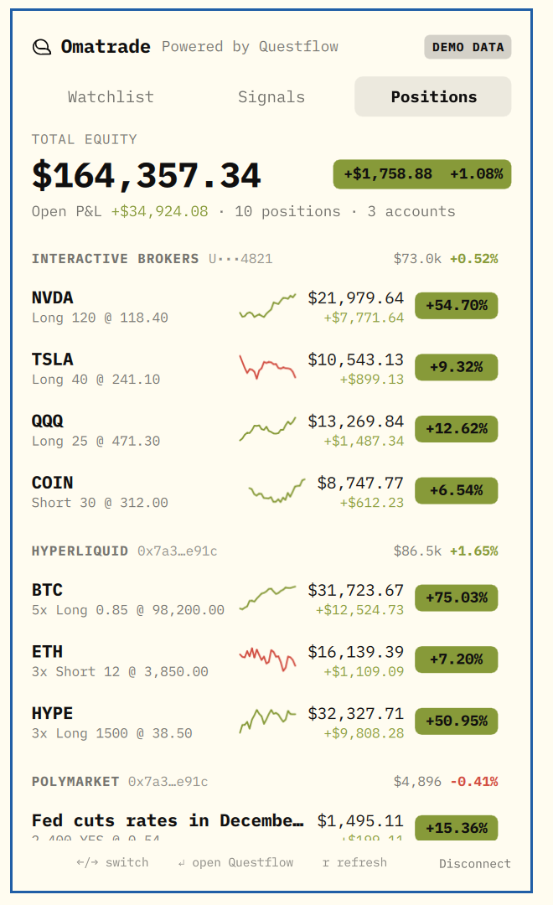

# Omatrade

**Your TradingView watchlist, the trading news behind it, and your positions — in the
[Omarchy](https://omarchy.org) bar.** Powered by [Questflow](https://questflow.ai/?utm_source=omatrade&utm_medium=omarchy-plugin).

| Watchlist | Signals | Positions |
|---|---|---|
|  |  |  |

- **Watchlist** — live quotes for the symbols you follow. Search TradingView and add from the
  panel, drag to reorder, remove with one key, click a row to open its chart on TradingView.
- **Signals** — the latest trading news for your watchlist, newest first. Breaking stories
  arrive as a desktop notification.
- **Positions** — brokers, Hyperliquid and Polymarket in one place, once you connect
  Questflow. *Questflow sign-in is not live yet: connecting shows demo accounts, labelled
  `DEMO DATA`.*

Read-only by design. Omatrade never places orders, signs transactions or asks for a password.
It follows your Omarchy theme and is keyboard-first.

## Install

```sh
omarchy plugin add https://github.com/questflowai/omatrade --enable
```

Optionally put the CLI on your path:

```sh
ln -s ~/.config/omarchy/plugins/questflow.omatrade/bin/omatrade ~/.local/bin/omatrade
```

Requires Omarchy 4 and Python 3.11+ (standard library only, no dependencies).

## Use

The bar wears the first symbol on the watchlist: its name and price beside the
icon, with the day's change in the tooltip. Click the icon, or bind a key to
`omarchy-shell questflow.omatrade toggle`.

| Key | |
|---|---|
| `←` `→` / `1` `2` `3` | Watchlist · Signals · Positions |
| `↑` `↓` | select |
| `↵` | open chart / story / Questflow |
| `a` or `+` | add a symbol (type, `↑` `↓`, `↵`; `esc` to cancel) |
| `x` | remove the selected symbol |
| `⇧J` `⇧K` | move the selected symbol down / up (or drag its ⠿ grip) |
| `r` | refresh |

IPC: `omarchy-shell questflow.omatrade watchlist|signals|positions|add|toggle|refresh`

### CLI

```sh
omatrade                      # watchlist, news, positions
omatrade tv search tencent    # find symbols on TradingView
omatrade tv add HKEX:700 [--section Asia]
omatrade tv remove 700
omatrade tv move --before=NASDAQ:NVDA -- HKEX:700   # or --after= / --section=
omatrade tv import [file]     # a TradingView export (default: newest in ~/Downloads)
omatrade news
omatrade login | logout       # Questflow (demo accounts for now)
omatrade summary --json       # everything the bar reads
```

### Bring your TradingView watchlist

TradingView has no API for watchlists, and Omatrade will not read your browser's TradingView
session. Export instead: in TradingView open the watchlist menu → **Export list…**, then run
`omatrade tv import`. Importing replaces the current list. The list lives in
`~/.config/omatrade/tradingview.txt`, in TradingView's own format.

## How it works

`bin/omatrade` owns the data and derives the palette from the current Omarchy theme; the
plugin (`Service.qml`, `Panel.qml`) polls `omatrade summary --json` and draws it. Quotes are
cached for 45 seconds and news for 5 minutes; when offline the last data stays on screen
with a note.

## Privacy and security

- No account, password, API key or browser session is read or stored. Questflow sign-in,
  when it ships, keeps its token in the system keyring.
- To fetch quotes and news, the symbols on your watchlist are sent to TradingView, along with
  your IP address. Nothing is sent to Questflow.
- Only `https://` links are ever opened; text from news feeds is shown as plain text.
- The watchlist and caches are private to your user (`0700` directories, `0600` files).
- Plugins run unsandboxed in the Omarchy shell. `omarchy plugin update` shows the diff before
  applying it — read it.

## Disclaimer

Omatrade is not affiliated with, endorsed by or sponsored by TradingView. Quotes, symbol
search and news come from TradingView's public web endpoints, which are unofficial,
may be delayed, and may change or stop working at any time. Nothing shown is investment
advice.

## Uninstall

```sh
omarchy plugin remove questflow.omatrade
rm -rf ~/.local/state/omatrade ~/.config/omatrade ~/.local/bin/omatrade
```

## License

MIT © 2026 Questflow. `Sparkline.qml` is from [Omacharts](https://github.com/jorgemanrubia/omacharts),
MIT © 2026 Jorge Manrubia — see [THIRD_PARTY_NOTICES.md](THIRD_PARTY_NOTICES.md).
